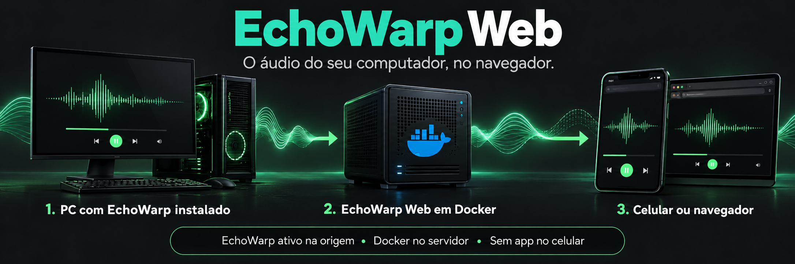

# EchoWarp Web



Ouça o áudio do seu computador pelo navegador do celular ou de outro dispositivo.
O EchoWarp Web recebe a transmissão de um servidor EchoWarp e oferece um painel
com reprodução ao vivo, histórico de 30 minutos, velocidades de 1x a 3x e gravações.

> **Antes de começar:** é necessário instalar e executar o **EchoWarp na máquina
> que fornece o áudio**. O painel web depende dessa transmissão para receber som.
> No celular, basta abrir o navegador; não é necessário instalar o EchoWarp.

## Como as peças se conectam

```text
Computador de origem           Servidor Linux                  Celular / PC
EchoWarp instalado e ativo  →  EchoWarp Web em Docker       →  Navegador
Captura o áudio               Recebe e publica a transmissão   Reproduz o áudio
```

| Onde | O que precisa estar instalado | O que fazer |
| --- | --- | --- |
| Máquina que fornece o áudio | [EchoWarp](https://github.com/lHumaNl/EchoWarp) | Iniciar no modo servidor e selecionar o dispositivo de captura ou loopback. Manter a máquina ligada e o EchoWarp em execução. |
| Máquina que hospeda o painel | Linux, Docker e Docker Compose | Executar este projeto. A imagem já inclui o cliente EchoWarp 0.9.2, PulseAudio e FFmpeg. |
| Celular ou computador que vai ouvir | Navegador compatível com HLS ou HLS.js | Abrir o endereço do painel, fazer login e tocar o áudio. |

O computador de origem e o servidor Docker podem ser a mesma máquina Linux,
desde que ela também execute o EchoWarp no modo servidor e tenha a captura
configurada. Se forem máquinas diferentes, o servidor Docker precisa alcançar
o IP e a porta do EchoWarp na origem. O navegador precisa alcançar o painel web.

**São duas senhas independentes:** a senha do painel (`WEB_AUTH_PASSWORD`) permite
entrar no site; a senha do EchoWarp deve coincidir com a configurada no servidor
de origem e é informada ao cadastrar a conexão no painel.

Fluxo interno do container:

```text
EchoWarp server -> EchoWarp client no container -> PulseAudio virtual -> FFmpeg HLS -> navegador
```

O web UI tambem controla o EchoWarp: scan de servidores LAN, conexao manual, senha, porta, devices, duplex, STUN, TLS, reconnect, server/conference, recording, restart, stop, doctor e logs.

## Requisitos

- Docker com Docker Compose em Linux.
- Celular e servidor Docker na mesma rede.
- EchoWarp instalado e executando no modo servidor na máquina que tem o áudio de origem.
- Dispositivo de captura correto na origem: para transmitir o som do sistema no Windows, use um dispositivo de loopback.

### Preparar a máquina de origem (Windows)

1. Baixe e extraia o [EchoWarp](https://github.com/lHumaNl/EchoWarp/releases) na máquina cujo áudio deseja ouvir.
2. Abra o PowerShell na pasta do executável e liste os dispositivos:

   ```powershell
   .\EchoWarp.exe devices
   ```

3. Identifique o dispositivo de captura ou loopback e inicie o servidor. Substitua `1` pelo ID encontrado e escolha sua senha:

   ```powershell
   .\EchoWarp.exe server --no-interactive --device 1 --port 4415 --password minhaSenha --max-clients 1
   ```

4. Mantenha esse processo aberto e anote o IP da máquina. No painel web, cadastre esse IP, a porta `4415` e a mesma senha.

Se o servidor EchoWarp estiver parado, a máquina estiver desligada ou o dispositivo
selecionado não estiver capturando som, o painel não receberá áudio da origem.

O compose usa `network_mode: host` para permitir mDNS/discovery e expor a pagina na porta escolhida.

## Como rodar

O formulario de login permite salvar usuario e senha pelo gerenciador do navegador.
A oferta de salvamento depende das configuracoes do navegador. A opcao
**Manter conectado por 30 dias** preserva a sessao nesse periodo, inclusive apos
reiniciar o container. Sem essa opcao, vale `WEB_SESSION_TTL_SECONDS` (12 horas
por padrao). Sair encerra a sessao; trocar o usuario ou senha do painel invalida
as sessoes anteriores. O banco de sessoes fica no volume persistente.

Crie o `.env`:

```powershell
Copy-Item .env.example .env
```

Exemplo:

```env
ECHOWARP_SERVER=
ECHOWARP_PORT=4415
ECHOWARP_PASSWORD=
WEB_PORT=3008
WEB_AUTH_USER=admin@example.com
WEB_AUTH_PASSWORD=CHANGE_ME_BEFORE_START
ECHOWARP_DEVICE_NAME=EchoWarpWeb
```

Suba o container:

```powershell
docker compose up -d --build
```

Abra no celular:

```text
http://IP_DO_DOCKER:3008
```

A tela de login fica ativa por padrao. O usuario padrao e `admin@example.com`; altere `WEB_AUTH_USER` e `WEB_AUTH_PASSWORD` no `.env` se precisar trocar.

Para expor somente no Tailscale, descubra o IP Tailscale do host com `tailscale ip -4` e defina:

```env
WEB_HOST=100.x.y.z
```

Nesse modo, acesse por:

```text
http://IP_TAILSCALE_DO_DOCKER:3008
```

Pela pagina web voce pode adicionar servidores com nome, IP, porta e senha, conectar em qualquer servidor salvo e scanear a rede para adicionar servidores encontrados.

Se ficar em `auth_error`, a porta respondeu mas a senha do EchoWarp nao bate com a senha do server de origem.

Se conectar mas ficar sem audio, olhe o campo `Audio` na pagina:

- `sem sinal`: o EchoWarp Web esta tocando o HLS, mas nada esta chegando no sink `EchoWarpWeb`. No computador de origem, rode `EchoWarp.exe devices` e inicie o server com um device de loopback/captura do audio do sistema.
- `sinal baixo`: existe audio chegando, mas o nivel esta baixo. O HLS usa `AUDIO_FILTER` para normalizar o volume antes de enviar ao navegador.
- valor em `dBFS / pico`: o audio esta chegando no container; se ainda nao ouvir, recarregue o player ou confira volume/mudo no navegador/celular.

Se o audio zerar por mais de `SILENCE_RESTART_SECONDS`, o container reinicia o client EchoWarp automaticamente. Defina `SILENCE_RESTART_SECONDS=0` para desativar esse watchdog.

## Gravacoes e desconexao

O audio HLS guarda automaticamente uma janela dos ultimos 30 minutos enquanto
o container esta rodando. Use **Voltar no audio** para ouvir o historico e
**Voltar ao vivo** para retornar. A janela cresce desde a inicializacao;
reiniciar o container limpa esse historico temporario. Ele inclui silencio
quando a origem esta desconectada.

O seletor de velocidade do player permite ouvir o historico em **1x, 1.5x, 2x
ou 3x**. A velocidade e mantida ao navegar pelo historico e retorna a 1x ao
alcancar o ao vivo ou clicar em **Voltar ao vivo**.

**Salvar historico** salva os ultimos 1 a 30 minutos disponiveis em M4A no volume
persistente, com a mesma retencao e download das gravacoes. Quando ainda nao
existem 30 minutos, salva somente o periodo disponivel. O historico usa os
mesmos segmentos do player, incluindo o filtro de audio.

Use **Desconectar** no player para parar a conexao e cancelar reconexoes automaticas.
Para voltar, conecte a um servidor salvo. Desconectar ou trocar o servidor tambem
encerra a gravacao atual.

Use **Gravar** e **Parar gravacao** para salvar o audio recebido no servidor.
Os arquivos M4A sao divididos em partes de aproximadamente 30 minutos e podem
ser baixados na pagina depois que cada parte terminar. A parte em andamento
fica disponivel ao encerrar a gravacao. O audio e gravado antes do filtro HLS.

Configure **Manter arquivos por (horas)** e clique em **Salvar periodo**.
O padrao e 168 horas (7 dias), tambem configuravel inicialmente com
`RECORDING_RETENTION_HOURS`. A escolha na interface e persistida e prevalece
sobre o ambiente. A limpeza roda a cada minuto e exclui partes finalizadas
mais antigas que o periodo configurado, inclusive durante uma gravacao longa.
Reduzir o periodo aplica a limpeza imediatamente.

Os arquivos ficam em `/home/echowarp/.config/echowarp-web/recordings`, no volume
Docker existente, e sobrevivem a recriacoes do container. Listagem e downloads
exigem a mesma autenticacao da pagina. A gravacao nao reinicia automaticamente
quando o container e reiniciado.

## Latencia

O player permite buffer manual entre 1 e 10 segundos ou automatico (padrao).
No automatico, o alvo comeca em 2 segundos, sobe 1 segundo quando ha cortes
(no maximo uma vez a cada 10 segundos) e cai 0,5 segundo a cada 2 minutos de
reproducao estavel, ate 2 segundos. A escolha fica salva no navegador.
O HLS mantem pelo menos 30 segmentos para comportar essa margem.
No player HLS nativo, o navegador limita o controle sobre o buffer.

O padrao usa segmentos HLS de `0.5s`, player com alvo de `2s` atras do ao vivo e
`AUDIO_FILTER=dynaudnorm=f=75:g=3:p=0.95` para reduzir a espera do normalizador.
HLS ainda acrescenta atraso; a latencia real depende da rede e do navegador,
especialmente no Safari, que usa o player HLS nativo.
O HLS.js e preferido quando suportado; o player nativo e usado como alternativa.
A captura PulseAudio usa fragmentos de aproximadamente 20 ms. O alvo do player
nao e uma garantia de latencia total: inclui-se ainda a captura na origem,
EchoWarp, normalizacao, codificacao e transporte dos segmentos.

Se seu `.env` usa os valores antigos, altere `HLS_TIME=0.5` e
`AUDIO_FILTER=dynaudnorm=f=75:g=3:p=0.95` e aplique com
`docker compose up -d --build`. Para desativar o filtro, use `AUDIO_FILTER=`.
Em redes instaveis, `HLS_TIME=1` oferece mais margem contra interrupcoes.

As reconexoes pendentes sao canceladas ao parar ou reiniciar o client, e logs
de processos antigos nao alteram o estado da conexao atual.

## EchoWarp server de origem

No computador que tem o audio:

```powershell
EchoWarp.exe devices
EchoWarp.exe server --no-interactive --device 1 --port 4415 --password minhaSenha --max-clients 1
```

Depois configure na pagina web:

```text
Servidor: IP_DO_COMPUTADOR
Porta: 4415
Senha: mesma senha
```

Para transmitir audio do sistema no Windows, escolha um device de loopback na lista do `EchoWarp.exe devices`.

## Portas

- `WEB_PORT/tcp`: pagina web e API, padrao `3008`.
- `4415/tcp` e `4415/udp`: EchoWarp server.
- `4416/tcp`: probe de sessao do EchoWarp.
- `5353/udp`: mDNS/discovery na LAN.

Se o celular nao abre a pagina, libere `WEB_PORT/tcp` no host Docker. Se o client nao conecta, libere as portas EchoWarp no computador de origem.
